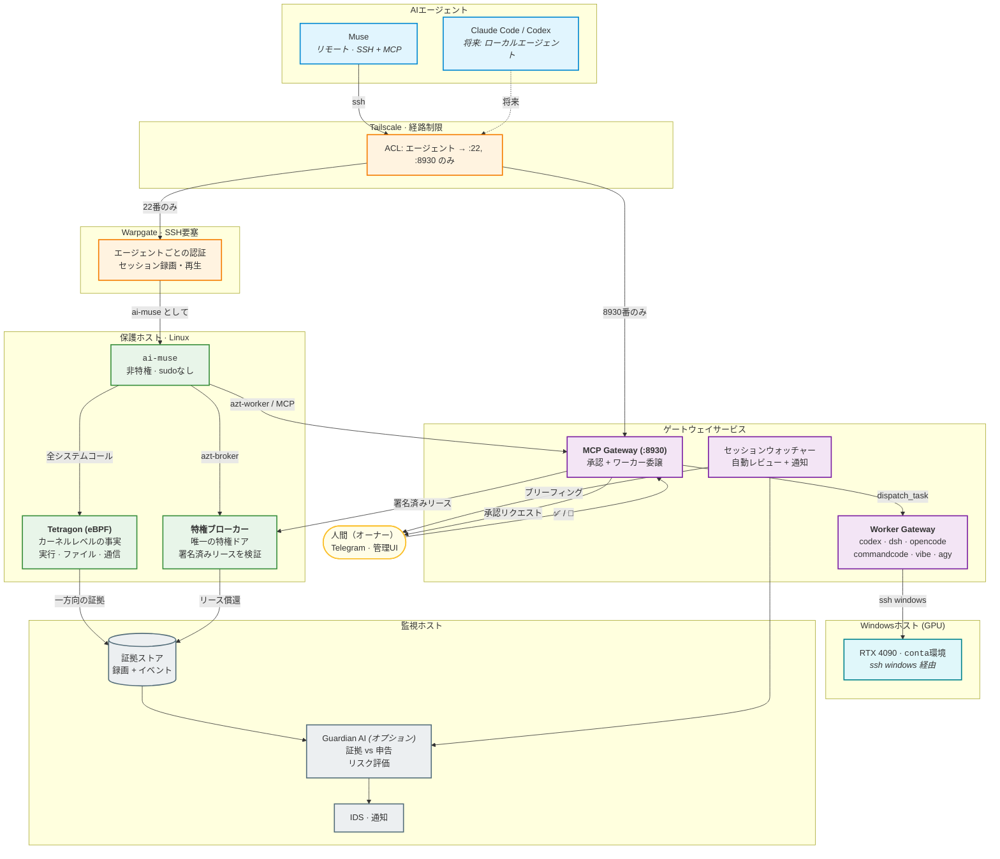

# agent-zerotrust

[English](README.md) | **日本語**

**AIエージェントのためのゼロトラスト・セキュリティゲートウェイ**

AIエージェントにマシンへの本物のアクセスを与える — ただし、信用はしない。

`agent-zerotrust` は、AIエージェント（Muse、Claude Code、Codex、Hermes、…）に
ローカル環境への**監査可能で制約されたアクセス**を提供し、事後に「実際に
何をしたのか」を証明できるようにする、オープンな共通基盤です。

> **ステータス: 設計フェーズ / PoC。** まだ何もデプロイされていません。
> 現在のマイルストーンは
> [Milestone 1 — 監査可能なSSHアクセス](docs/issues/001-auditable-ssh-access.md)。
> この先の方向性は [ロードマップ](docs/roadmap.md) を参照してください。

## なぜ必要か

AIエージェントは、開発マシンへの事実上のインタラクティブシェルアクセスを
手にしつつあります。主流のモデルは*エージェントを信用する*ことです。
SSH鍵を渡して、その行動がスコープ内に収まることを祈るだけ。

Meta の
[Muse のセキュリティアプローチ](https://research.meta.ai/blog/security-and-safety-for-ai-agents-our-approach-with-muse)
は**エージェント自身の実行環境**を守ります — 独立した Sentinel が権限制御を
担当し、ランタイムはサンドボックス化され、eBPFが通信を制限する。
それはエージェント側を守る仕組みです。

このプロジェクトは、その反対側を守ります: **エージェントが接続してくる
マシン**。あなたのデータ、あなたの認証情報、その背後にあるLANごと。

前提はゼロトラストです:

- 認証されたセッションは、信用されたセッションではない
- すべての操作は仲介され、記録され、説明可能である
- 証拠は、監視対象が決して届けない場所に置かれる
- セキュリティの土台は**AIなしで**機能する — Guardian AI はその上に
  意味分析を追加するオプション層であり、それが落ちても土台は動き続ける

## アーキテクチャ



**核心となる問題は相関（correlation）**： Warpgate は*エージェントが打ったもの*を、Tetragon は*実際に起きたこと*を教えてくれます。この2つを紐付けて初めて、セッションは監査可能になります。

**承認ループ**： 拒否された特権操作は機械可読な拒否IDを伴い → エージェントがMCPで承認を要求し → 人間がTelegramでタップし → 署名済みの期限付きリースが鋳造され → ブローカーが検証・償還して、束縛された操作だけを実行します。

**Worker Gateway**： エージェントに認証情報を渡すことなく、到達範囲を広げます。エージェントは MCP Gateway に「タスクを委譲」を依頼し、ローカルのCLIエージェント（codex, dsh, opencode, commandcode, vibe, agy）がオーナーの環境で実行します。Windows 側の作業は `ssh windows` 経由のみ（マウントや追加ユーザーは使いません）。すべての委譲は安全チェック・監査・Telegram通知の対象です。

**現在のIDS/IPSの立ち位置**： IDSは稼働中（セッション自動レビュー + Telegram通知）。IPSは「OS境界での許可ベース」で実効（`ai-muse` にsudoなし、特権操作はブローカー経由、通信は観測のみでデフォルト拒否は未実装）。egressのデフォルト拒否とTetragonによる強制は Phase 3 の残項目です。

詳細は [docs/architecture.md](docs/architecture.md) を参照してください。

## 設計原則

1. **印象ではなく証拠。** 監査性は、エージェントが画面に表示することを
   選んだものの上ではなく、カーネルレベルの事実（eBPF）の上に立つ。
2. **AIオプショナル設計。** アクセス制御・記録・証拠は、AIゼロで動く。
   Guardian AI は拡張である — 実行できる人には深い行動分析を提供するが、
   依存は決してさせない。
3. **改ざんに耐える証拠。** 監視対象はモニターを止められない、録画を
   編集できない、証拠ストアに届かない。
4. **バイパスなし。** Warpgate が正面玄関なら、裏口は存在しない —
   直接SSHの経路は「勧告」ではなく技術的に塞ぐ。
5. **証拠そのものを守る。** セッション録画には秘密が入りうる。その機密性と
   保持は、後付けではなく設計要件である。

資産・敵モデル・脅威・要件の完全な分析は
[docs/threat-model.md](docs/threat-model.md) にあります —
このリポジトリの軸となる文書です。

## ロードマップ

| フェーズ | 目標 | 主要技術 | 完了条件 |
|---|---|---|---|
| 1 | エージェントの実際の行動を完全に追跡する | Warpgate + Tetragon | [Milestone 1](docs/issues/001-auditable-ssh-access.md) のチェックリスト |
| 2 | 独立したAIがその操作を評価する | Guardian AI + LLM | 実セッションのリスクスコア化、アラート |
| 3 | 危険な操作を自動的に阻止する | ポリシーエンジン + IPS | エージェントユーザーの実行/egress のデフォルト拒否 |

詳細: [docs/roadmap.md](docs/roadmap.md)。

*検知*と*阻止*の間には、もう一段あります: **人間の承認
（human-in-the-loop）**。危険な操作をワンタップの承認でゲートできます —
要求は証拠コンテキストとともに Telegram で届き、承認はその操作そのものに
束縛され、沈黙は拒否を意味します。設計メモは
[docs/architecture.md](docs/architecture.md) §8。

## リポジトリ構成

```text
agent-zerotrust/
├── README.md
├── README.ja.md            日本語README（このファイル）
├── LICENSE                  Apache-2.0
├── docs/
│   ├── architecture.md      コンポーネント、相関、フェイルセーフ挙動
│   ├── threat-model.md      資産、敵モデル、脅威、要件
│   ├── roadmap.md           フェーズと完了条件
│   └── issues/              Issue 化の準備ができたマイルストーン
├── deploy/
│   ├── warpgate/            要塞設定、ターゲット/ユーザーマッピング
│   ├── tetragon/            トレーシングポリシー（実行 / ファイル / 通信）
│   └── monitoring/          証拠パイプライン、保持
├── guardian/               オプションの Guardian AI（証拠を消費、強制はしない）
├── policies/
│   ├── network/             Tailscale ACL、egress ポリシー
│   └── execution/           実行ポリシー（Phase 3）
└── tests/
    └── security/            脅威モデルを検証する攻撃シナリオスクリプト
```

## 関連プロジェクト

- [Meta: Security and safety for AI agents — our approach with
  Muse](https://research.meta.ai/blog/security-and-safety-for-ai-agents-our-approach-with-muse)
  — エージェント自身のランタイムを守る。`agent-zerotrust` は接続先を守る。
- [Warpgate](https://warpgate.null.page/) — セッションの録画と再生に対応した
  SSH要塞（bastion）。
- [Tetragon](https://tetragon.io/) — eBPFベースのセキュリティ監視・強制。
  Kubernetesは不要で、通常のLinuxホストで動く。
- [Tailscale](https://tailscale.com/) — ACLつきWireGuardメッシュ。経路制限に使用。

## ライセンス

[Apache-2.0](LICENSE)
