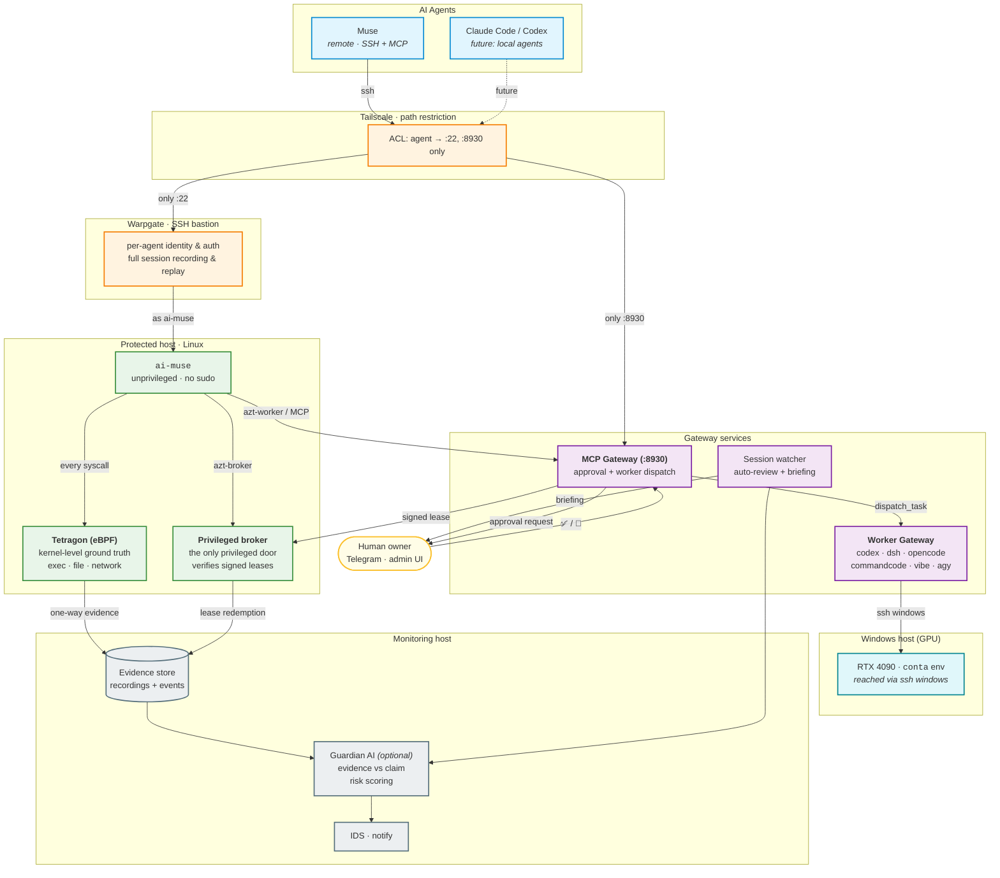

# agent-zerotrust

**English** | [日本語](README.ja.md)

**Zero Trust Security Gateway for AI Agents**

Give AI agents real access to your machines — without trusting them.

`agent-zerotrust` is an open foundation for providing AI agents (Muse and
others) with **audited, constrained access to local environments** — and for
proving, after the fact, exactly what they did. Beyond SSH, it can *delegate*
work to local CLI agents (Codex, DSH, OpenCode, Command Code, Mistral Vibe,
Antigravity) without ever handing the remote agent their credentials.

> **Status: deployed and running.** Phase 1 (auditable SSH access) and
> Phase 2 (auto-review, Telegram briefings, MCP approvals, LLM backends) are
> complete; Phase 3 (privileged broker + signed permission leases) is core
> complete. See [deploy/README.md](deploy/README.md) for the live deployment
> record and [docs/roadmap.md](docs/roadmap.md) for what remains.

## Why

AI agents increasingly get what is effectively interactive shell access to
development machines. The prevailing model is *trust the agent*: hand it an
SSH key and hope its behavior stays in scope.

Meta's [security approach for Muse](https://research.meta.ai/blog/security-and-safety-for-ai-agents-our-approach-with-muse)
guards the **agent's own execution environment** — an independent Sentinel
handles privilege control, the runtime is sandboxed, and eBPF restricts its
communications. That protects the agent.

This project protects the other side: **the machine the agent connects to.**
Your home server, with your data, your credentials, and your LAN behind it.

The premise is zero trust:

- An authenticated session is not a trusted session.
- Every action is mediated, recorded, and explainable.
- Evidence lives where the monitored principal cannot reach it.
- The security floor works **with no AI at all** — Guardian AI is an
  optional layer that adds semantic analysis on top, and the floor keeps
  working when it is down.

## Architecture



**The key problem is correlation**: what the terminal shows is not what the kernel did. Warpgate tells you *what the agent typed*; Tetragon tells you *what actually happened*; correlating the two makes the session auditable.

**The approval loop** closes the other direction: a denied privileged operation carries a machine-readable denial ID → the agent requests approval via MCP → the human taps on Telegram → a signed, bounded lease is minted → the broker verifies and redeems it, executing exactly the bound action.

**The worker gateway** extends the agent's reach without giving it credentials: the agent asks the MCP Gateway to *dispatch a task* to a local CLI agent (codex, dsh, opencode, commandcode, vibe, agy). The worker runs under the owner's environment, and Windows work is reached through `ssh windows` — never through mounts or extra Windows users. Every dispatch is safety-screened, audited, and briefed to Telegram.

**The audit gate** sits between the gateway and the worker. Each request is classified by [Jev](https://docs.typesafe.ai) (TypeSafe's System One model — a typed `Choice` question answered in 150–300 ms, with no text generation, so no ideological drift):

| Category | Action |
|---|---|
| ordinary work | run |
| NSFW content | run |
| secrets (keys, tokens, `.env`) | **ask the owner on Telegram** |
| monitoring (stops or tampers with it) | **ask the owner on Telegram** |
| destructive operations | **ask the owner on Telegram** |

A deterministic pattern screen runs first and can only *raise* the category, never lower it. Requests that need approval wait for a Telegram button tap and fail closed after ten minutes. Worker output is classified again before it returns, so a secret that leaks into a result is withheld (the full text stays in the evidence store). Every notification shows the delegating node, the category, and the confidence.

**Current IDS/IPS posture**: IDS is live (session review + Telegram briefings). IPS is enforced as *allow-by-default at the OS boundary* (no sudo for `ai-muse`, broker-mediated privileged ops, network observed but not default-denied). Default-deny egress and Tetragon enforcement remain Phase 3 follow-ups.

See [docs/architecture.md](docs/architecture.md) for the full detail.

## Getting started

Three things to set up: the protected host, the gateway, and the agent that
connects to it. The example below uses Muse; any SSH-capable agent works.

### 1. The protected host

You need a Linux machine you control, reachable over Tailscale. Install
Docker and Tailscale, then:

```bash
git clone https://github.com/ganpare/agent-zerotrust
cd agent-zerotrust

# Warpgate (SSH bastion) and Tetragon (kernel observation)
docker compose -f deploy/warpgate/docker-compose.yml up -d
docker compose -f deploy/tetragon/docker-compose.yml up -d
```

Create the unprivileged user the agent will run as, and give it no sudo:

```bash
sudo useradd -m -s /bin/bash ai-muse
sudo passwd -l ai-muse
```

Warpgate records every session and authenticates to the target with its own
generated key. Add that public key to `ai-muse`'s `authorized_keys`
(`docker exec warpgate warpgate client-keys` prints it).

### 2. The gateway

The MCP gateway is the agent's control plane: approvals and worker
delegation both go through it.

```bash
# the approval store and the broker
sudo cp deploy/approvals/agent-zerotrust-mcp.service /etc/systemd/system/
sudo cp deploy/broker/agent-zerotrust-broker.service /etc/systemd/system/
sudo cp deploy/broker/azt-broker deploy/broker/azt-worker /usr/local/bin/
sudo systemctl enable --now agent-zerotrust-mcp agent-zerotrust-broker
```

Set `APPROVAL_BIND` to the tailnet address and `WARGATE_URL` to the Warpgate
admin URL in the unit file. Telegram credentials go in
`deploy/monitoring/state/telegram.json` (mode 0600, gitignored):

```json
{"bot_token": "...", "chat_id": "..."}
```

The audit gate needs a TypeSafe key. Set `TYPESAFE_API_KEY` directly, or
point `INFISICAL_URL` / `INFISICAL_PROJECT` / `INFISICAL_CRED_DIR` at an
[Infisical](https://infisical.com) instance holding it.

### 3. Connect the agent

Two ways in, both landing on the same gateway.

**Over MCP** (recommended — the agent gets the tools directly):

```json
{
  "mcpServers": {
    "agent-zerotrust": {
      "url": "http://<PROTECTED_HOST_IP>:8930/mcp"
    }
  }
}
```

**Over SSH** (when the agent has no MCP client, or you want the session
recorded too):

```bash
ssh muse:<PROTECTED_HOST>-local@<PROTECTED_HOST_IP>
# then, inside the session:
azt-worker agents
azt-worker run opencode "run the test suite" --target linux
```

`azt-worker` posts to the same `:8930/mcp` endpoint, so the audit gate and
the approval flow apply exactly as they do for MCP clients.

### 4. Restrict the path

The agent should reach **only** the SSH port and the MCP port. In the
Tailscale ACL:

```jsonc
{
  "grants": [
    { "src": ["tag:agent-muse"], "dst": ["<PROTECTED_HOST>"],
      "ip": ["22", "8930"] }
  ],
  "tagOwners": { "tag:agent-muse": ["autogroup:admin"] }
}
```

Tag the agent's device, and everything else on the tailnet is unreachable
from it — including the evidence store.

### MCP tools

| Tool | Purpose |
|---|---|
| `request_approval(action, justification, ...)` | ask the owner for an exception |
| `get_approval(request_id)` | poll the decision |
| `list_worker_agents()` | which CLI agents are available |
| `dispatch_worker_task(agent, instruction, target, workdir)` | delegate to a local agent |
| `get_worker_task(task_id)` | fetch a task's status and output |

### What the owner sees

Every delegation, block, and completion arrives in Telegram with the
delegating node, the Jev category, and the confidence:

```text
⚠️ agent-zerotrust — ワーカー依頼の承認が必要です
依頼元: muse / tag:agent-muse (100.101.102.103)
分類: 秘密鍵・認証情報（信頼度 1.00）
エージェント: codex (対象: windows)
リクエスト: WREQ-1794101166-5a33d1

依頼内容:
cat ~/.ssh/id_ed25519 を表示してください

10 分以内に回答がなければ拒否として扱います。
[✅ 承認] [🚫 拒否]
```

See [deploy/README.md](deploy/README.md) for the full runbook, the port
map, and the lessons from the reference deployment.

## Design principles

1. **Evidence over impressions.** Auditability rests on kernel-level ground
   truth (eBPF), not on what the agent chose to print.
2. **AI-optional by design.** Access control, recording, and evidence work
   with zero AI. Guardian AI is an enhancement: deep behavioral analysis for
   those who can run it, never a dependency for those who cannot.
3. **Tamper-resistant evidence.** The monitored principal cannot turn off
   the monitors, edit recordings, or reach the evidence store.
4. **No bypass.** If Warpgate and the MCP Gateway are the front doors,
   there must be no back door — direct SSH paths are technically blocked
   (sshd is LAN/loopback only; the tailnet's port 22 *is* Warpgate), not just
   discouraged.
5. **Protect the evidence itself.** Session recordings can contain secrets;
   their confidentiality and retention are design requirements, not
   afterthoughts.

The full asset/adversary/requirement analysis is in
[docs/threat-model.md](docs/threat-model.md) — the axis document of this
repository.

## Roadmap

| Phase | Goal | Key tech | Status |
|---|---|---|---|
| 1 | Fully track what agents actually do | Warpgate + Tetragon | **complete** — [Milestone 1](docs/issues/001-auditable-ssh-access.md) |
| 2 | An independent AI evaluates the actions | Guardian AI + LLM | **complete** — auto-review, Telegram, MCP approvals, Codex/DSH backends |
| 3 | Automatically block dangerous actions | policy engine + IPS | **core complete** — privileged broker + signed leases; egress default-deny remains |

Details: [docs/roadmap.md](docs/roadmap.md).

Between *detect* and *block* there is a middle rung: **human-in-the-loop
approval**. A risky action can be gated on a single tap — the request,
with its evidence context, reaches you over Telegram; the approval is
bound to that exact action; silence means deny. Design note:
[docs/architecture.md](docs/architecture.md) §8.

## Repository layout

```text
agent-zerotrust/
├── README.md
├── README.ja.md            Japanese README
├── LICENSE                  MIT
├── docs/
│   ├── architecture.md      components, correlation, fail-safe behavior
│   ├── threat-model.md      assets, adversaries, threats, requirements
│   ├── roadmap.md           phases and exit criteria
│   └── issues/              ready-to-file milestone issues
├── deploy/
│   ├── warpgate/            bastion config, target/user mapping
│   ├── tetragon/            tracing policies (exec / file / network)
│   ├── monitoring/          evidence pipeline, session watcher unit
│   ├── approvals/           MCP gateway systemd unit
│   └── broker/              privileged broker unit + azt-worker CLI
├── guardian/               optional Guardian AI (consumes evidence, never enforces)
│   └── wrappers/            Codex / DSH CLI wrappers
├── evidence/               correlation, case builder, rule backend, Telegram
├── approvals/              MCP gateway: request_approval + worker dispatch
├── broker/                 privileged broker: leases, ledger, policy
├── workers/                Worker Gateway: local CLI agent dispatch
├── policies/
│   ├── network/             Tailscale ACL (applied)
│   └── execution/           execution policy (Phase 3)
└── tests/
    ├── security/            attack-scenario scripts validating the threat model
    └── *.py                 unit tests (65/65)
```

## Related work

- [Meta: Security and safety for AI agents — our approach with Muse](https://research.meta.ai/blog/security-and-safety-for-ai-agents-our-approach-with-muse)
  — protects the agent's own runtime; `agent-zerotrust` protects the target.
- [Warpgate](https://warpgate.null.page/) — SSH bastion with session
  recording and replay.
- [Tetragon](https://tetragon.io/) — eBPF-based security observability and
  enforcement; runs on plain Linux hosts, no Kubernetes required.
- [Tailscale](https://tailscale.com/) — WireGuard mesh with ACLs, used to
  restrict the network path.

These are used as dependencies (Docker images and client tools), not copied
into this repository. Their licenses are their own: Warpgate and Tetragon are
Apache-2.0, Tailscale's client is BSD-3-Clause. This project is MIT, which is
compatible with using them.

## License

[MIT](LICENSE)
